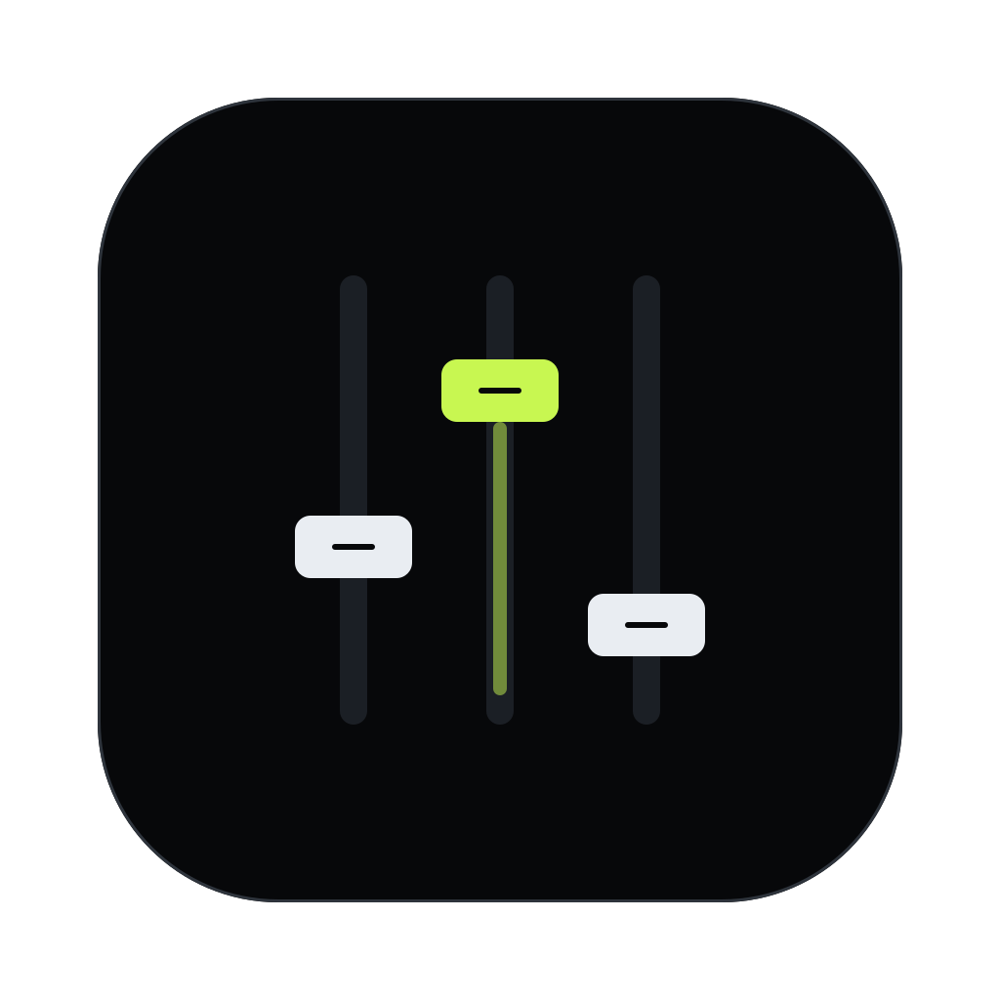
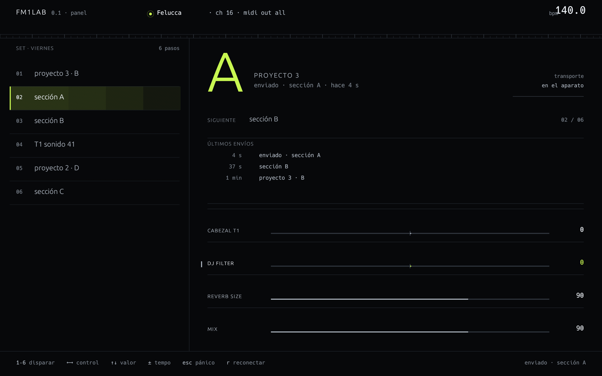

<p align="center">
  
</p>

# fm1lab

Laboratorio de escritorio y panel de performance para el **M-VAVE FM-1**. Detecta el firmware, elige
un **perfil** y adapta el panel: franjas asignables, monitor/learn de CC/NRPN, transporte, setlists y
una biblioteca de firmwares con verificación SHA-256, backup e instalación OTA.



## Instalar en macOS

```bash
brew install --cask quicio/tap/fm1lab
```

Homebrew 5+ no carga casks de taps de terceros hasta confiarlos. Si aparece
`Refusing to load cask ... from untrusted tap`:

```bash
brew trust quicio/tap
```

El cask instala `FM1Lab.app` en `/Applications` y enlaza `fm1ctl` como comando de terminal.

```bash
open -a FM1Lab          # el panel
fm1ctl ports            # puertos MIDI visibles
fm1ctl profile          # perfil detectado y disponibles
fm1ctl firmware         # biblioteca y estado de los paquetes
brew uninstall --cask fm1lab           # desinstalar (conserva la config)
brew uninstall --cask fm1lab --zap     # desinstalar y borrar ~/.config/fm1lab
```

La app no está notarizada por Apple. El cask intenta quitar la cuarentena; si macOS bloquea la
primera apertura, usá **clic derecho → Abrir**.

## Uso rápido

| tecla | qué hace |
|---|---|
| `↑` `↓` | elegir franja |
| `←` `→` | mover el valor (`shift`, de a 8) |
| `espacio` | play/stop (Start + clock MIDI) |
| `a` | asignar un parámetro a la franja |
| `m` / `k` | monitor MIDI / aprender un CC-NRPN |
| `p` | selector de perfil |
| `f` | biblioteca de firmwares |
| `esc` | pánico |

La configuración vive en `~/.config/fm1lab/` (`setlist.json`, `panel.json`, `profile.json`,
`profiles/`, `firmwares.json`, `backups/`).

## Compilar

```bash
cargo run --profile fast -p fm1-perf          # la ventana
cargo run --profile fast -p fm1ctl -- ports   # la CLI
scripts/check.sh                              # la puerta completa
scripts/make_icns.sh                          # assets/icon.png -> assets/fm1lab.icns
scripts/make_app.sh target/dist/fm1-perf target/FM1Lab.app
```

Perfiles de Cargo: `fast` para iterar, `release` para uso, `dist` para distribuir.

## Firmwares

La biblioteca instala paquetes `.fwsc` por OTA/Felucca. Antes de escribir verifica el SHA-256,
respalda config y paquetes, pausa transporte/sondeo/monitor y pide confirmación explícita.

La ruta la decide `fm1-core::route`, no quien instala: misma familia o desde el firmware oficial es
directo; de fork a fork también es **directo**, con aviso (el stock V16 no es un paquete Felucca y no
puede ser paso intermedio). En modo update no se empieza otra escritura. `fm1ctl route <id>` muestra la
ruta sin tocar el aparato.

**Cambiar de fork puede dejar la zona de datos (proyectos/presets) incompatible.** El stock se instala
con M-UPGRADE; el instalador Python de `m-vave` queda como rescate.

## Documentación

- [`AGENTS.md`](AGENTS.md) — comandos y reglas duras.
- [`docs/HANDOFF.md`](docs/HANDOFF.md) — estado medido e invariantes.
- [`docs/ARCHITECTURE.md`](docs/ARCHITECTURE.md) — capas, perfiles y protocolos.
- [`docs/ROADMAP.md`](docs/ROADMAP.md) — milestones.
- [`docs/NRPN.md`](docs/NRPN.md) — mapa de parámetros.
- [`openspec/`](openspec) — cambios y specs.

## Licencia

MIT. Ver [`LICENSE`](LICENSE).
